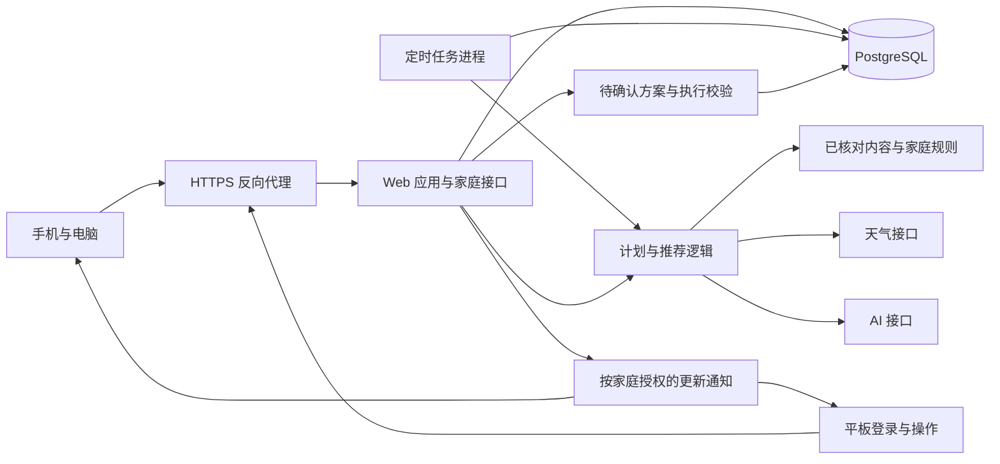

# 宝宝计划｜技术方案与实施顺序

版本：v0.11。更新：2026-10-30（Asia/Shanghai）。状态：与产品需求 v1.0、开发规格 v0.6 对齐，补充回收站、删除恢复与自动补缺边界。下列架构、数据结构和实现方式仍为工程方案，尚待环境检查与实现验证。产品待定事项和资源核查统一见[需求对齐与待定事项](需求对齐与待定事项.md)，具体契约见[接口与数据模型](接口与数据模型.md)。

商业规则以[分享与家庭会员方案](分享与家庭会员方案.md) 为准：按家庭收费，先邀请试用，初期用激活码交付会员。当前真实账号、支付、会员、公开分享及到期导出仍待实现。

## 1. 已知条件与建议结论

| 项目 | 已知事实 | 来源与边界 |
| --- | --- | --- |
| 服务商与类型 | 京东云轻量云主机 | 用户提供的控制台截图 |
| 地域 | 华北北京 | 截图中选中的实例列表地域 |
| CPU / 内存 | 4 核 / 8GB | 套餐规格，实际占用未知 |
| 带宽 | 5Mbps | 套餐标注；月流量、峰值及实际使用情况待查 |
| 系统 | Ubuntu 22.04 64 位 | 截图中的镜像名称；系统更新情况待查 |
| 实例状态 | 截图记录为运行中 | 尚未实机复核当前状态 |
| 到期时间 | 2026-12-09 23:59:59 | 控制台显示的时间 |
| 应用代码 | 已有 A 方向本地前端原型；真实账号、后端、AI 等服务尚未接入 | 本地文件检查，原型状态见 `web-ui/README.md` |
| 旧项目入口 | 本机已有“萌食计划”小程序源码，开发者工具可访问该小程序及测试号 | 配置与登录见[微信登录接入核查](微信登录接入核查.md)；所选 4 人家庭的[首批复用清单](首批资料复用清单.md)已确定必要基本资料＋11 条菜谱草稿，历史计划和流水后置 |

建议以这台服务器作为自家和邀请试用阶段的部署候选，承载 Web 应用、数据库和定时任务。AI 建议通过外部服务接口完成。当前不建设家庭照片存储与处理服务；实际可承载的家庭数量仍需结合现有业务占用、磁盘、数据量、接口延迟和压测结果判断。

服务器的公开地址和账号标识无需写入产品文档；后续部署配置按实际环境管理。

## 2. 推荐架构

建议使用 TypeScript + Next.js 构建响应式 Web 与服务端接口，使用 PostgreSQL 保存家庭和计划数据。同一代码库包含 Web 服务与独立任务进程，采用版本化内容库和服务端规则生成日常建议。

应用、任务进程和数据库可按环境采用容器部署。反向代理负责 HTTPS 与路由。Next.js 官方支持自托管，并建议在服务前配置反向代理；具体版本应在实施时锁定受支持的稳定版本。[Next.js 自托管文档](https://nextjs.org/docs/app/guides/self-hosting)

该路线是工程建议。若旧小程序已有可复用且维护良好的后端，在检查接口与数据后比较迁移成本，再确定最终边界。

## 3. 成员账号、家庭与多端登录

采用独立成员账号和家庭成员关系。每次请求从已验证会话取得身份，再检查家庭成员资格及角色。

| 成员角色 | 能力 |
| --- | --- |
| 家庭管理员（爸爸） | 修改日常计划与资料、宝宝关键资料、禁忌和自动生成设置，管理成员，选择共同提醒；管理本人设备会话；内容启用范围仅管理员可修改 |
| 日常编辑成员（妈妈、奶奶） | 换餐、调整活动与时间，修改食材、近期偏好及模板，新增文字与反馈记录；只更正或删除本人记录；宝宝关键资料、禁忌及自动生成设置仅管理员可改 |

管理员可更正或删除其他成员记录，保留原作者与更正历史；管理员与编辑成员均不能查看他人的 AI 私有聊天或待确认方案。

手机、电脑和平板使用同一套成员登录与会话机制。平板直接登录家庭成员账号，修改安排、提交与查看记录均按成员权限校验。平板模式只控制布局与字号，不建立独立设备身份或只读令牌，也不增加手机配对流程。

会话失效后在当前设备重新登录；支持退出当前会话和撤销本人其他设备会话。移除成员后停止其对此家庭的访问，不接管其账号。各设备可保存本机的视图偏好，视图切换不会改变账号角色或家庭范围。

首版采用邮箱＋密码，首次验证邮箱；通过已验证邮箱发送一次性密码重置链接，成功后撤销旧会话和旧重置凭证并要求重新登录。邮箱登录、家庭邀请与家庭成员权限分别校验。验证和重置由后端邮件适配器发送，发信供应商、域名、投递与退信处理待落实；具体流程和工程参数见开发规格，字段与约束见接口文档。微信登录留待后续扩展，已有用户继续使用稳定内部标识。

会员权益挂在家庭上，与成员角色分开。一位成员购买后，家人分别登录并共享有效权益，邀请家人不另收费；购买不会赋予业务编辑或成员管理权限。试用码、激活码与家庭邀请使用独立流程，后者只建立被授权的成员关系。到期不删除家庭、成员或登录身份，继续按权限提供已有内容的查看与导出。

## 4. 数据结构建议

| 实体 | 核心内容 |
| --- | --- |
| `users` / `sessions` / `auth_tokens` | 已验证邮箱与密码摘要、可撤销会话、邮箱验证和邮件重置凭证；各用途和期限独立校验 |
| `households` / `household_members` | 家庭、时区、城市、成员关系及角色；与家庭付费权益分别保存 |
| `household_invites` | 目标家庭、邀请人、拟授角色、令牌摘要、有效期、接受或撤销状态 |
| 试用码／会员码 / `code_redemptions` | 用途、摘要、可兑换期限、权益版本、订单或赠送来源、单次兑换记录；具体分表在 S2／S3 接口设计中确定 |
| `entitlement_grants` | 家庭、试用或付费等授予来源、套餐与额度版本、有效区间、撤销依据及审计信息 |
| `orders` / `order_events` | 经核实的订单、商品价格与期限快照、支付或人工核实记录、退款和交付事件；付费阶段接入 |
| `children` / `food_profiles` | 月龄依据、明确禁忌与确认状态；近期偏好另存 `preferences` |
| `routine_templates` | 工作日与周末时段、照护角色 |
| `pantry_snapshots` / `pantry_items` | 食材、粗略余量、优先消耗、确认时间 |
| `content_items` / `content_versions` | 菜谱、活动、穿搭规则、照护提示及版本 |
| `content_sources` | 标题、机构或作者、原始链接、版本或日期、具体章节或段落、适用条件、核对记录及素材使用信息 |
| `content_source_links` | 内容版本与具体出处的关系、支持的结论、原文摘要或本地改编说明 |
| `recommendation_evidence` | 推荐对应的内容版本、家庭记录或食材快照、天气输入与规则版本；分别保存一般原则和当天选择理由 |
| `weather_snapshots` | 查询地点、供应商与归因、当前或预报类型、有效时段、取数时间、可获得的数据时间、可用状态；字段与保存期限按服务产品验证 |
| `household_content_settings` / `household_agreements` | 分别保存家庭启用的内容范围与共同提醒，按各自字段权限处理 |
| `daily_plans` / `plan_items` | 家庭日期、餐次与活动、时间、来源、修订号 |
| `plan_item_versions` | 计划条目的历史版本，保存标题、时间、内容版本和变更来源 |
| `preferences` / `feedback` | 近期喜好及有效期；可选反馈关联具体记录或某次日程，保留日期 |
| `event_records` / `record_revisions` | 家长文字、参与情况、发生日期及时间精度、记录人、填写时间、更正历史，可关联原计划版本 |
| `ai_conversations` / `ai_messages` | 家庭、发起人、会话可见范围、消息和当前讨论日期范围 |
| `change_proposals` / `proposal_operations` | 结构化改动、前置版本、日期范围、预览版本、确认人、执行状态和幂等键 |
| `plan_changes` | 修改人、修改范围、前后版本与时间 |
| 本机视图偏好 | 平板模式、字号等保存在当前设备；认证与撤销使用已有 `sessions`，无需独立展示设备表 |
| `generation_jobs` / `usage_events` | 生成任务、重试、接口用量及费用依据 |

邀请、权益及订单实体按实施阶段接入，不表示已建表。付费状态由有效权益记录计算，不用成员关系或前端布尔开关代替；外部试用前需完成试用权益、用量、到期查看与导出，订单和付费激活在付费测试阶段完成。

家庭业务数据包含 `household_id`；宝宝相关条目同时关联 `child_id`。跨表引用也校验家庭一致性，服务端不直接信任客户端提交的家庭标识。

建议在应用授权外增加 PostgreSQL 行级安全策略作为补充边界。数据库的表所有者、超级用户和 `BYPASSRLS` 角色存在绕过策略的情况，因此运行账号、策略及连接上下文需要一并设计并测试。[PostgreSQL 行级安全文档](https://www.postgresql.org/docs/current/ddl-rowsecurity.html)

时间戳统一保存，家庭日程日期按家庭时区计算；本家庭默认 Asia/Shanghai。首版界面先围绕一个宝宝使用，数据结构保留宝宝关联能力。

## 5. 计划生成与局部调整

### 5.1 日常生成

首次使用按初始化流程准备今天；用户已确认之后每天晚上准备次日，一周计划按需生成并确认。具体执行时刻建议可配置；任务只补缺，不覆盖人工安排。

1. 从家庭工作日或周末模板取得当天的安排骨架。
2. 读取月龄、已确认禁忌、近期偏好、食材快照、天气和已启用内容。
3. 按适用条件和禁忌过滤候选内容，再由排序规则或 AI 选择组合。
4. 校验候选引用、时段、家庭权限和内容状态，将安排保存为可追溯版本。
5. 向获授权的家庭客户端发出更新通知。

默认安排可以自动展示，自动生成的范围受内容状态与家庭设置约束。资料缺失、关键原料标注不完整或尚未核对的内容保留候选状态。

### 5.2 修改一餐

请求携带餐次标识、期望修订号和替换意图。服务端检查编辑权限与版本后，在事务中只修改所选餐次及其直接依赖项，更新计划修订号并写入变更记录。

父母并发修改同一条目时返回明确冲突，客户端取得最新内容再提交。原有人工修改与生成来源分开记录，定时任务不能静默覆写人工决定。

修改食材或偏好后，可以提供受影响条目的候选调整；用户选择具体影响范围。天气事实和穿搭建议可刷新，已选活动不会因天气刷新自动被替换；改活动仍通过获授权成员的明确操作或 AI 方案确认。

### 5.3 幂等与恢复

- 以家庭、宝宝和日期约束同一天的计划唯一性，任务重试检查已有结果。
- 生成任务保存状态、输入版本和幂等键，避免重复调用及重复发布。
- AI 超时或失败时保留既有安排；当天尚无内容时展示作息骨架，并允许选择已核对条目。
- 漏执行的任务可以恢复，但不会把上一天的日期和内容伪装成今日生成结果。

### 5.4 AI 对话方案与确认执行

对话查询使用当前成员有权访问的家庭数据。模型提出的写操作先进入方案草稿；正式写入由应用执行器负责，模型不能直接提交数据库语句或绕过确认。

1. 记录家庭、宝宝、明确日期范围和上下文版本；“这周”“明天下午”按家庭时区解释并在界面显示具体日期。
2. 将意图整理成受支持的结构化业务操作，例如调整餐次、增加活动、修改食材优先级或设置有期限的偏好。参数和目标条目逐项校验。
3. 读取当前数据计算差异，保存待确认方案。预览基于真实前后值生成，包含直接受影响的菜谱、购物需求和相关版本。
4. 用户继续讨论时产生新的预览版本，旧版标记已替换。明确的“确认并保存”提交方案标识与预览版本。
5. 确认时再次校验成员权限、目标家庭、各项前置版本、内容适用条件及方案状态。在一个数据库事务中执行该组业务改动、写变更记录并标记已执行。
6. 提交成功后发送更新通知，返回保存结果和目标页面；模型调用、天气查询等外部耗时操作不放入该事务。

方案状态建议为“草稿、待确认、已替换、已执行、冲突、取消”。版本冲突时整组业务改动不部分写入，返回受影响项并生成可重新核对的预览。重复确认或网络重试通过幂等键返回同一执行结果。数据库已提交但客户端未收到响应时，查询执行状态后再展示结果。

后台按已启用规则形成默认安排，与新对话中的待确认方案分别保存。已确认的人工修改保留来源与版本，后台任务不能覆盖；后台更新触及方案依赖时，也须按冲突规则重新核对。服务端处理范围包含对一周多个日期的改动，而非只支持当天。

## 6. 内容库与 AI 的分工

已确认的资料选择与产品规则见[内容来源与推荐规则](内容来源与推荐规则.md)。以下状态和存储方式为实现建议，不代表具体条目已核对或天气服务已接入。

内容建议经历“草稿 → 出处及适用条件已核对 → 可供家庭启用”的状态变化，并保留操作者、说明和版本。实际是否经过专业人员审核，应单独记录，界面表述必须与真实审核过程一致。

AI 用于理解对话需求、候选排序、日常组合、解释及生成待确认改动。模型输出中的内容标识、原料、年龄条件、禁忌和操作参数由服务端校验；模型返回的链接或解释本身不能自动变成已核对依据。

建议采用结构化输出，并从已选候选条目的真实出处生成引用。外部材料作为待核对内容处理，不能改变家庭权限或执行系统操作。

每次推荐保存实际参与筛选的输入与引用关系：一般原则对应支持该结论的原文位置，具体做法对应内容版本及改编说明，当天理由对应真实家庭记录或天气输入。服务端校验引用存在、关联版本和家庭权限；内容核对确认资料确实支持相应结论，不能仅凭存在一个链接就视为有效依据。

天气优先候选为和风天气。接入前验证账号、额度、费用、服务器访问情况、接口字段和归因要求。查询区分地点、当前天气与活动时段预报；缓存键包含地点、产品类型和时段等实际查询条件。数据有效性依据所用产品更新节奏确定，供应商数据时间与取数时间分别保存；缺失字段保持未知，过时或失败时不能作为实时依据。穿搭规则引用天气输入、活动方式及规则版本；自动刷新天气与修改已选活动沿用各自的权限和确认规则。

只有任务所需的月龄、场景、偏好和相关记录等信息进入模型调用。引用历史观察时保留记录标识与日期，区分家长原文和模型推测；推测不会自动变成长期偏好。家庭照片功能已退出当前范围。服务密钥保存在服务端配置中。每次调用记录模型、输入版本、用量、耗时和结果状态，方便核算和复现。

## 7. 日历与文字记录

日历按家庭时区与日期范围查询正式计划和实际记录；月概览返回安排、记录标记，选中日再读详情。AI 草稿不混入正式计划，周安排由同一份按日数据聚合。

记录可关联某次计划条目及其具体版本，也可独立补记。关联时保存当时标题、时间与内容版本；替换活动、改模板或取消安排不删除已有记录。发生日期按家庭本地日期保存，填写时间和修改时间单独记录。

文字、参与情况和兴趣反馈至少有一项，参与与兴趣可分别为空。感想不自动生成完成状态；同一活动的多次记录互相独立。更正使用修订号避免覆盖，仅作者或家庭管理员可更正和删除，保留原作者与更正历史。

家庭生活照片上传、私有相册、记录附件及照片导出不在当前架构范围。菜谱和活动说明配图作为内容素材发布。2026-10-31 用户单独新增衣服库：压缩衣物照片与资料存入 `wardrobe_items`，通过家庭会话鉴权读取，不发布到静态目录；备份与恢复需包含照片字节和元数据。服务端用已锁定的 sharp 重新解码去除元数据，具体限制与验收见 [CR 衣物搭配](../specs/baby-plan/wardrobe.md)。

数据库备份覆盖计划、记录、内容版本与成员关系，并验证关联完整。AI 聊天和未确认方案仅发起人可见，家庭管理员也不例外；通知、审计摘要及家庭导出不泄露私有聊天。

自家使用期间不按计划或记录年龄清理。明确删除进入 30 天回收站，取消计划仍是可回看的状态；恢复记录只限原作者或管理员，计划沿用日常编辑权限。删除正文不进入普通读取及新推荐／AI 检索，到期后禁止恢复并清理不再需要的正文及修订；必要审计不复制完整正文。删除计划不级联删除实际记录，记录所需的当时快照独立保留。

恢复操作重新校验权限、截止时间、对象和目标日计划修订，采用同一幂等结果；冲突时先预览，不覆盖新内容。主动删除、取消或留空的计划位置保留最小状态，自动任务不得重新填回。备份期限单独确定，恢复演练须核对备份点之后的删除及成员撤销动作；无法核对时保持恢复库隔离，避免旧权限或过期正文重新生效。

## 8. 手机、电脑和平板同步、离线与常亮

建议采用普通 HTTPS 接口提交修改，通过 Server-Sent Events 将更新通知发送到对应家庭，再拉取该家庭的最新家庭计划与记录数据。SSE 是服务器向客户端的单向连接，适用于这类更新通知。[MDN：使用 SSE](https://developer.mozilla.org/en-US/docs/Web/API/Server-sent_events/Using_server-sent_events)

通知、读取和写入接口均检查成员会话、家庭范围与操作权限。事件只提示最新修订号等必要信息，重新连接后获取完整快照。推送暂不可用时可降级为低频轮询；页面显示最后同步时间和连接状态。

建议以“推送正常时保存后 5 秒内更新其他在线设备”作为待实测目标。断网时保留当前会话已取得的内容并明确标为离线，恢复联网后重新校验成员会话并取得最新版本；会话过期则在本机重新登录。无网络且重新打开页面时，显示真实的联网要求。

未提交输入仅保留在当前身份的编辑上下文中；重连后核对最新版本再由成员重试，不建立自动覆盖的离线写入队列。提交响应丢失时先查询原操作结果，避免重复记录。退出或切换身份后清除旧内容展示，不将其自动提交给新身份。

Web 常亮需要基于实际设备验证。Screen Wake Lock API 要求安全上下文，系统省电、低电量或页面失去可见性可能使其释放；恢复到前台时需要重新申请。该能力不等同于网页能控制设备的所有休眠行为。[MDN：Screen Wake Lock API](https://developer.mozilla.org/en-US/docs/Web/API/Screen_Wake_Lock_API)

打印页读取生成时的计划版本，继承相同家庭权限，并标记日期与更新时间。打印样式可由浏览器打印实现，先验证实际纸张可读性。

## 9. 现有服务器的部署评估

部署前读取并记录以下实际状态：CPU 和内存占用、磁盘容量及剩余量、已有应用与端口、数据库、容器环境、反向代理、域名、系统更新和备份方式。确认可用余量后，为新系统分配独立应用目录、进程、数据库和备份路径。

建议初期结构为：HTTPS 反向代理、Web 服务、任务进程、PostgreSQL。数据库仅向应用网络开放；备份放在与运行数据分离的位置，并进行恢复验证。具体备份服务与保存期限结合现有资源决定。

页面以清楚的文字和按需加载的内容配图为起点，对 5Mbps 带宽设置页面与素材体积预算并实测。数据库容量与备份按照实际计划、记录和版本数量评估。构建过程和运行过程分别评估资源需求，避免仅凭套餐规格判断余量。

从北京节点验证所选 AI、天气和邮件服务的可用性、延迟、服务地域与用量限制。域名、DNS、HTTPS 及该部署地域的公开访问接入条件在正式上线前核实；当前尚未确认用户的域名情况。事务邮件另需发信域名验证和发件地址配置，实测家人邮箱的收件、重试及退信；应用服务器不另行自建邮件投递系统。

到期时间为控制台显示的 2026-12-09 23:59:59，需在确定试用上线窗口时一并确认后续续费安排。

## 10. 旧小程序复用评估

源码位于本机 `/Users/jackx/workspace/msjh`。截至 2026-10-30，已通过已登录开发者工具定向只读核查用户选定的 4 人“五一”家庭：11 条个人菜谱、98 条食材档案和 122 条状态记录；未查到独立禁用规则，设备偏好值仍未知。归属、去重与分页证据见[旧资料核查](旧小程序资料复用核查.md)。

[首批清单](首批资料复用清单.md)已准备 11 条菜谱草稿，保留 74 项原料、51 条原步骤、原用量及提示，并为 58 项自由文本逐条分类。加工形态、可选变式、复合配料与用量依据单独保留，候选关联不直接触发营养换算或内容启用。原文缺项先核对做法，不由生成模型补成事实。

在本地运行旧源码的纯状态合并函数，得到 98 项旧通过、另 4 项旧未尝试被有效清单排除；三个跨表差异样本另用列表函数交叉核对。技术合并无需用户选择优先表，但新系统仍需家庭确认当前情况。源码版本与读取快照均记录摘要，不以此宣称线上部署版本或业务接口已验证。

用户已确认首批采用必要基本资料＋全部 11 条菜谱草稿，历史计划和流水后置。历史生成内容与家庭实际确认过的记录保持区别；迁移先在测试数据上验证数量、内容及权限，再进行实际导入。目前未创建新系统数据或迁移工具，也不能由这些资料推断旧后端可整体复用。早期仅检查登录与配置的结果作为独立历史记录保留在[微信登录接入核查](微信登录接入核查.md)。

## 11. 实施里程碑

沿用产品需求的 S1～S4，以及开发规格在 S1 内的 B0～B4。旧稿 M0～M6 编号停用，避免把共享计划的首条流程误当成完整首版。

| 阶段／批次 | 交付内容 | 验证方式 |
| --- | --- | --- |
| S1／B0 规格与环境 | 对齐规则和接口草案，补齐邮箱登录、初始化、邀请与来源页面；核查服务器、旧资料及存储条件 | 规则对应到页面和服务端校验；区分原型演示与真实服务 |
| S1／B1 首条真实流程 | 登录、建家庭、邀请、保存一天安排、手机和平板同步 | 家庭隔离、成员权限、撤销、并发修改及跨设备保存验证 |
| S1／B2 内容与记录 | 食材、菜谱、活动与来源、日历、按次文字与反馈记录、回收站、打印 | 局部修改保持、记录独立、作者权限、保存重试、30 天恢复及历史回看 |
| S1／B3 自动运行与 AI | 次日计划、天气穿搭、个人对话、方案预览和一次确认 | 人工安排保护、整组写入、冲突与幂等、依赖服务失败恢复 |
| S1／B4 自家验收 | 真机连续一周使用及数据库恢复 | 覆盖工作日和周末，确认保存、同步、删除恢复与权限，备份恢复后核对撤销／删除流水 |
| S2 外部试用 | 10～20 个家庭、7 天试用、家庭权益和用量、到期查看与导出；提前明确额度和保存期限 | 试用兑换与到期行为；观察持续使用、操作负担和支持成本 |
| S3 收费测试 | 单一家庭会员、订单、激活码、续费、退款及权益管理 | 单次兑换、并发续费及退款；价格和额度有成本依据 |
| S4 公开推广 | 产品介绍、可预览及撤销的公开快照、购买成功直接开通 | 私有数据隔离、支付通知幂等、容量和服务成本实测 |

测试围绕真实失败风险：家庭隔离、成员会话与权限、局部修改保持性、方案确认与并发冲突、内容约束、任务幂等、历史记录独立性、记录保存失败恢复，以及平板恢复与本机重新登录。目前以本地前端原型验证交互，真实账号、服务端权限与跨设备同步仍需工程验证。

试用和会员阶段增加凭证用途隔离、并发单次兑换、重复试用、家庭共享额度、到期访问与后台任务、订单幂等和退款不影响其他权益的检查，具体场景见[分享与家庭会员方案](分享与家庭会员方案.md)。此轮只更新设计文档，不创建生产服务或执行收费。

## 12. 成本如何核算

用户要求费用在具体方案确定后再看，因此当前没有固定月度预算。

| 成本项 | 核算依据 |
| --- | --- |
| 已有服务器 | 实际续费价格、原有业务分摊和可用资源 |
| AI | 模型单价、家庭数、对话轮次、上下文长度、生成和替换次数、实际输入输出用量、重试 |
| 天气 | 接口套餐、地区数量、缓存周期及查询次数 |
| 登录与邮件 | 邮箱验证、密码重置的实际邮件量及所选服务费用；供应商和额度待核实 |
| 数据、备份与内容素材 | 数据库规模、内容配图、访问流量、备份保留与恢复需求；无家庭照片存储成本 |
| 内容维护 | 条目整理、出处核对、适用性复核和后续维护投入 |

天气按地区和时间窗口缓存，计划保存生成结果，重复打开页面直接读取已有内容。按家庭记录真实调用量、数据量、流量、备份和支持投入；AI 额度须在外部试用与售卖前明确，具体数值以实测决定，不承诺无限用量。29 元／家庭／30 天仅是测试报价，不能据此认定覆盖成本或形成正式年费。

## 13. 方案核对时使用的技术资料

- [Next.js 官方自托管指南](https://nextjs.org/docs/app/guides/self-hosting)
- [PostgreSQL 官方行级安全策略文档](https://www.postgresql.org/docs/current/ddl-rowsecurity.html)
- [MDN：Server-Sent Events](https://developer.mozilla.org/en-US/docs/Web/API/Server-sent_events/Using_server-sent_events)
- [MDN：Screen Wake Lock API](https://developer.mozilla.org/en-US/docs/Web/API/Screen_Wake_Lock_API)

以上资料用于核对技术能力。文中具体组件组合、数据结构和验收目标是本项目的工程建议，仍需结合现有环境实施验证。

## 14. 试用、会员与公开分享的实现建议

### 14.1 凭证与权益

家庭邀请只创建成员关系；试用码和会员码分别创建有期限的权益记录。各入口在服务端验证用途、会话、目标家庭及相应管理权限；码使用不可预测随机值，摘要校验，日志不保存完整凭证。试用兑换的唯一性按家庭校验，换成员不重置；已付费家庭不能用试用替换原权益。

成功兑换需在同一事务内完成单次消费与权益写入，以唯一约束确保一码只有一次成功兑换，按家庭串行更新到期时间，避免两个正常续费同时提交时丢失其中一笔。请求幂等标识用于重试返回原结果；码的唯一性仍由数据库约束保证。目标家庭在兑换前预览，错误提示不泄露其他购买者或家庭资料。

兑换截止时间与服务区间分别保存。试用从成功兑换起计算，固定天数套餐从服务器时间与原有效到期时间中的较晚者起计算，预览与提交时重新核对。套餐、额度、金额及政策版本保存快照，更新售价不会修改已有订单。

### 14.2 订单、到期与额度

早期按经核实的订单交付激活码，记录核实人和依据；接入支付后验证服务端支付结果及金额、币种、订单归属。前端成功页面不能证明到账；重复支付通知和重复兑换都不能再次授予同一笔权益。订单与退款事件保留审计信息，退款或撤销只调整相应权益，并保留其他有效购买的服务时长。补发未用码时作废原码，已兑换订单使用原权益恢复流程，不额外生成一次开通机会。

各接口和后台任务统一检查成员权限、有效权益及家庭共享额度，不能仅隐藏前端按钮。AI 调用与定时生成在执行前检查。幂等重试不重复扣同一份业务额度，实际供应商调用成本另行记录。

到期后允许成员在其权限及预先告知的保存期限内查看和导出已有安排及文字反馈记录；删除自身获授权数据等管理能力独立于会员。新的付费生成停止，定时任务不继续产生付费调用；实际到期后的免费新增或手动编辑范围另行确定。存储清理、通知、导出覆盖范围及备份保留政策在外部试用开放前补齐，不用「永久保存」替代未确定的容量与期限。

### 14.3 公开内容

公开分享优先使用示例；真实内容需由有权成员主动选择并预览。服务端生成独立快照，只发布允许的字段，默认排除宝宝姓名、地点与家庭身份信息，不包含家庭会话、成员邀请令牌或可查询家庭记录的内部接口。

公开分享按单独标识读取，不直接读取家庭最新日历；修改私有安排不自动扩大公开范围。在线快照支持撤销，分享页指向产品介绍及新家庭体验入口。公开分享属于后续阶段，当前前端原型不能承担真实家庭资料的公开托管。
