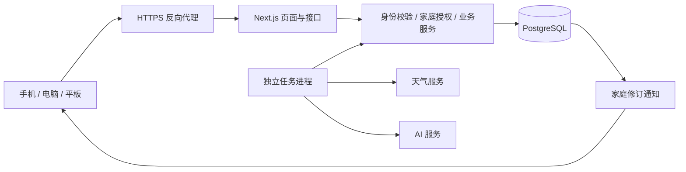
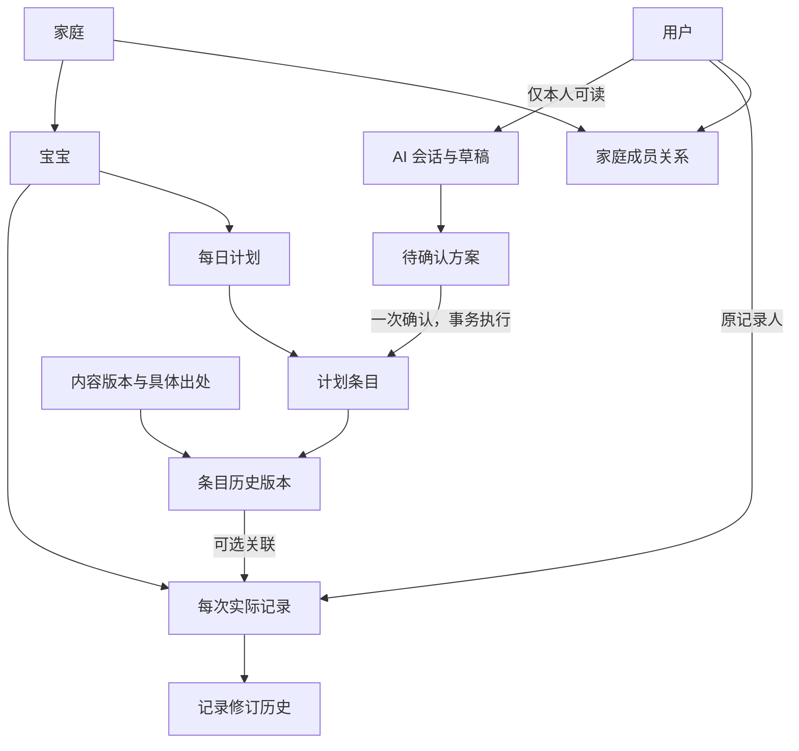

# 宝宝计划｜接口与数据模型

版本：v0.8，2026-10-31（Asia/Shanghai）。状态：B1 与 B2 本地功能已实现并验证。B2 实际路由、版本字段和清理边界见[B2 实现说明](B2本地实现说明.md)、src/shared/b2.ts 和 src/server/b2-http.ts；B1 见[B1 实现说明](B1本地实现说明.md)。天气、自动任务及 AI 的 B3 设计仍为草案；本页概念接口不自动等于已实现接口。未定政策见[需求对齐与待定事项](需求对齐与待定事项.md)。30 天回收站、到期清理与固定打印已接入。

本地 B1 补充：新增 POST H/plans {date} 创建手动日计划；宝宝关键字段的本批编辑入口为 PATCH H/child。尚未实现设置通用修改、当前密码修改和各后续模块接口，不以本页列出路径视为已经可用。邀请完整链接只返回一次；相同创建请求重试返回已创建提示，可在列表撤销后重建。生产邮件未配置时明确拒绝，Mailpit 只用于本机。

本文覆盖 S1 的主要接口与核心约束，S2～S4 只列扩展边界。每个模块实施时将本文件转为共享输入/返回类型、数据库迁移及可验证的接口定义；邮箱不可用时的人工恢复、对外留存等未定政策不得通过实现自行变成已确认规则。回收站与数据库备份是不同能力，30 天恢复规则不推定备份保存期。

## 1. 服务边界



图中的通知是应用读取数据库事件后发送 SSE，数据库不直接向浏览器暴露。家庭照片和媒体附件接口已退出本版；菜谱与活动说明配图采用内容素材发布。

业务服务供 HTTP 接口及任务进程共同使用。任务以明确的家庭和任务身份运行，不能省略内容限制、数据范围及后续权益校验。AI 只返回受支持的业务操作，不提供任意 SQL 执行能力。

## 2. 全部接口的共同约定

| 项目 | 约定 |
| --- | --- |
| 地址 | `/api/v1`；下文 `H` 代表 `/households/{householdId}`，实际请求必须带完整路径 |
| 身份 | 服务端会话 Cookie；从会话识别用户，再验证家庭成员关系；请求中的家庭标识仅用于定位 |
| 授权 | 用户 → 有效成员关系 → 具体操作 → 对象归属；聊天/方案另查发起人，记录写入另查作者或管理员 |
| 缓存 | 账号、家庭、聊天、记录等私有响应 `Cache-Control: private, no-store`；不得进入跨用户共享缓存 |
| 时间 | 业务日期为家庭时区的 `YYYY-MM-DD`；系统时间保存 UTC 时间戳并显式带时区返回 |
| 修订 | 可修改业务对象有整数 `revision`；修改时传 `expectedRevision`，按条件更新并检查受影响行数 |
| 幂等 | 创建记录、生成任务、确认方案等可重试操作使用 `Idempotency-Key`；同键同参数返回同结果，同键不同参数返回冲突 |
| 分页 | 范围列表采用明确日期范围或游标，返回 `nextCursor`；服务端限制请求范围与条目数量 |
| 查询限权 | 跨家庭对象和他人的私有草稿返回 404；已知对象上的不允许操作返回 403；未登录返回 401 |
| 写入保护 | Cookie 认证的写请求做同源与 CSRF 校验；登录、恢复、邀请消费分别限流 |
| 变更通知 | 数据写入、业务审计及待发送事件在同一事务中完成；提交后再通知客户端 |

幂等记录以用户、家庭、操作和键为作用域，并保存参数摘要、执行状态和结果引用；重放前仍检查当前权限。方案执行成功、邀请消费等业务事实另设永久唯一约束，不依赖短期幂等缓存。

成功响应使用 `data` 与 `meta`；`meta` 至少包含 `requestId`、`serverTime`，按需要返回修订号或分页信息。失败响应使用 `error: {code, message, retryable, fields?}` 与 `meta`，不返回数据库详情、密码、会话或其他家庭数据。

| HTTP | 业务代码示例 | 客户端行为 |
| --- | --- | --- |
| 400 / 422 | `INVALID_INPUT` / `CONTENT_NOT_ELIGIBLE` | 定位字段或不适用内容，保留已填信息 |
| 401 | `SESSION_EXPIRED` | 当前设备重新登录，清除旧身份的私有显示缓存 |
| 403 | `FORBIDDEN` | 提示缺少操作权限，不自动提高角色 |
| 404 | `NOT_FOUND` | 统一处理不可访问和不存在的对象 |
| 409 | `REVISION_CONFLICT` / `PROPOSAL_SUPERSEDED` / `IDEMPOTENCY_MISMATCH` / `RESTORE_CONFLICT` | 获取有权读取的最新版本，再核对改动或恢复位置 |
| 410 | `RESTORE_WINDOW_EXPIRED` | 仅在已确认有权操作的删除对象上告知恢复期限已过；不得借此暴露其他家庭对象 |
| 429 | `RATE_LIMITED` | 按返回的重试时间等待，不重复提交后台任务 |
| 503 | `DEPENDENCY_UNAVAILABLE` | 说明服务不可用，保留既有内容和待处理状态 |

耗时任务接收成功返回 202 与 `jobId`，不显示成业务已完成；最终状态可查询。不可重试的格式、权限及业务约束失败，不通过无限重试处理。

## 3. 身份与家庭接口

首版采用邮箱＋密码及邮件重置，微信授权和绑定接口留待后续。邮箱验证、受控注册、家庭邀请和设备会话分别校验；完成邮箱验证不自动取得家庭访问权。

| 方法与路径 | 输入 | 返回 / 要求 |
| --- | --- | --- |
| `GET /auth/csrf` | 无 | 当前会话或预登录流程的 CSRF 凭证 |
| `POST /auth/email/verification` | 邮箱、受控初始化或家庭邀请凭证 | 返回不可预测的 `challengeId` 及重试等待时间；向邮箱发验证码，不设置密码或创建家庭成员；按邮箱、来源和凭证限流 |
| `POST /auth/email/verify` | `challengeId`、验证码 | 原子检查用途、邮箱、期限和失败次数；成功后消费验证码并返回短期单次 `emailVerificationTicket`，绑定邮箱和注册准入凭证，不是业务登录会话 |
| `POST /auth/register` | `emailVerificationTicket`、显示称呼、密码、受控注册凭证 | 从票据取得已验证邮箱；同一事务重查邮箱唯一性、准入和邀请有效性，创建用户及适用的成员关系并消费凭证；首位管理员获得受控建家庭资格；完成后进入正常登录流程，不自动签发业务会话；已有用户须正常登录，不覆盖其密码 |
| `POST /auth/session` | 邮箱、密码、保持登录选择 | 仅已验证且启用的账号可取得会话 Cookie；错误不区分账号不存在与密码错误；设置会话前重查当前凭证版本 |
| `DELETE /auth/session` | 当前会话 | 服务端撤销并清除 Cookie |
| `GET /me` | 当前会话 | 本人资料、有权加入的家庭与角色、初始化状态 |
| `GET /auth/sessions` | 当前会话 | 仅本人的设备及最后活跃时间，不含完整令牌 |
| `DELETE /auth/sessions/{id}` | 本人会话标识 | 撤销指定会话，不允许撤销其他账号的全局会话 |
| `PUT /auth/password` | 当前密码、新密码 | 更新密码与凭证版本，撤销旧会话和未使用重置凭证，返回重新登录要求 |
| `POST /auth/recovery/request` | 邮箱 | 对已注册和未知邮箱统一返回受理提示；仅向启用账号的已验证邮箱发送重置链接，按邮箱和来源限流，不泄露账号是否存在 |
| `POST /auth/recovery/reset` | 邮件中的重置凭证、新密码 | 同一事务检查用途、目标用户、期限、凭证版本和未消费状态，更新密码并消费凭证；撤销全部旧会话及其他未使用重置凭证，返回登录页，不自动签发业务会话 |
| `POST /households` | 家庭称呼、时区、城市 | 创建家庭及管理员关系；S1 限受控初始化身份，S2 按新家庭流程开放 |
| `GET H` | 路径家庭 | 有权读取的家庭资料、设置修订号 |
| `PATCH H/settings` | 允许修改的字段、期望修订 | 管理员修改关键家庭设置；不得通过请求提升成员权限 |
| `PUT H/setup` | 宝宝资料、禁忌确认、模板、内容启用范围、期望修订 | 保存初始化进度；关键字段完整后可进入正式日常安排 |
| `GET H/members` | 家庭 | 成员称呼与角色；不返回账号凭证或聊天列表 |
| `PATCH H/members/{id}` | 新角色、期望修订 | 管理员；不能移除最后一个管理员的管理能力 |
| `DELETE H/members/{id}` | 期望修订 | 管理员撤销成员关系；保留历史作者引用，停止本家庭访问 |
| `POST H/invites` | 目标角色 | 管理员创建；返回一次展示的链接和有效期 |
| `DELETE H/invites/{id}` | 邀请标识 | 管理员撤销未使用邀请 |
| `POST /invites/preview` | 令牌 | 最小必要的家庭称呼、角色和有效状态；不返回家庭业务数据 |
| `POST /invites/accept` | 令牌，当前已登录且邮箱已验证的身份 | 同一事务检查未消费、创建成员关系并消费；注册接受邀请不重复使用此操作 |

邮箱保留输入原值供本人查看，去除首尾空格后按首版大小写不敏感规则生成唯一匹配键；不擅自折叠邮箱中的点号、加号或跨服务商别名。字符范围与国际化邮箱支持边界在实现时锁定，注册、登录和找回使用相同规范化方法。家庭成员列表显示称呼，不默认公开成员邮箱。

邮箱验证票据只在服务端检查后用于注册；未验证请求不预设用户密码、不建立家庭成员。验证码重发使同一注册流程的旧码失效，验证完成后邮箱被其他流程注册、邀请过期或撤销时，最终注册仍须拒绝相应写入；不得把重复注册变成账号接管。

验证和重置凭证均限定用途、目标、有效期和单次消费；随机长令牌存摘要，短验证码用服务端密钥保护的摘要并限制尝试次数。凭证不进入普通日志、统计或错误响应。重置页只允许可信站点地址，链接 GET 和邮件扫描不消费凭证，提交新密码的 POST 才完成变更；页面避免通过来源信息或第三方资源泄露令牌。[OWASP 密码重置指南](https://cheatsheetseries.owasp.org/cheatsheets/Forgot_Password_Cheat_Sheet.html)

初始会话、验证码和发送间隔参数见[开发规格 §5.1](开发规格.md#51-邮箱登录与找回流程)。密码建议使用成熟实现的 Argon2id 哈希；不自行设计密码算法，也不记录明文密码。[OWASP 密码存储指南](https://cheatsheetseries.owasp.org/cheatsheets/Password_Storage_Cheat_Sheet.html)

会话使用具有 Secure、HttpOnly、明确 SameSite 策略的 Cookie，服务端保存可撤销状态并执行失效规则；保持登录和敏感操作重新验证分别处理。[OWASP 会话管理指南](https://cheatsheetseries.owasp.org/cheatsheets/Session_Management_Cheat_Sheet.html)

## 4. 日常业务接口

| 方法与路径 | 输入 / 查询 | 返回 / 要求 |
| --- | --- | --- |
| `GET H/today` | `childId`、可选本地日期 | 正式计划、天气状态、提醒、更新时间；不混入 AI 草稿 |
| `GET H/calendar` | `childId, from, to` | 每日计划及记录标记；选中日再取详情 |
| `GET H/plans` | `childId, from, to` | 按日的正式计划与修订号 |
| `POST H/plan-jobs` | `childId, targetDate`，幂等键 | 初次使用或恢复时准备今天/明天，模式仅补缺；其他周计划走 AI 方案确认 |
| `POST H/plans/{id}/items` | 条目、时间、照护者、内容版本、期望计划修订 | 新增一个正式条目；写历史与变更记录 |
| `PATCH H/plan-items/{id}` | 时间/照护者/内容/场景、期望条目修订 | 仅改选定项及已核对的直接依赖；重新校验内容适用性 |
| `POST H/plan-items/{id}/cancel` | 期望修订，幂等键 | 标记取消，不删除已关联的记录和旧版本 |
| `DELETE H/plan-items/{id}` | 期望修订，幂等键 | 日常计划编辑权限；移入回收站，保留主动移除标记，不级联删除记录 |
| `POST H/plan-items/{id}/restore-preview` | 删除对象修订 | 返回当前日计划修订、拟恢复位置和直接影响，不执行恢复 |
| `POST H/plan-items/{id}/restore` | 删除对象修订、预览所用日计划修订，幂等键 | 重查当前权限、30 天截止与修订，合并恢复原条目；目标变化时返回冲突，不覆盖新安排 |
| `GET H/plan-items/{id}/versions` | 游标 | 有权访问的历史版本 |
| `GET H/templates` / `PUT H/templates/{kind}` | 工作日/周末；写入含时段和期望修订 | 新版本影响后续新安排，不静默重写已生成日期 |
| `GET H/pantry` / `PUT H/pantry` | 写入含食材、粗略余量、优先吃、期望修订 | 新食材快照和确认时间；不由计划自动扣库存 |
| `GET H/preferences` / `POST H/preferences` | 宝宝、偏好、作用范围、起止时间 | 有期限的偏好，与过敏禁忌分开 |
| `PATCH H/preferences/{id}` / `DELETE H/preferences/{id}` | 变更及期望修订 | 修改或结束偏好，不追溯重写旧计划 |
| `GET H/content` | 内容类型、宝宝、场景、游标 | 可见且适用的公共内容及本家庭内容 |
| `GET H/content-settings` / `PUT H/content-settings` | 写入含内容启用范围、期望修订 | 家庭成员可读，仅管理员可改；妈妈、奶奶仍可在已启用范围内换餐或调整活动 |
| `GET H/content/{id}/versions/{version}` | 具体内容版本 | 步骤、适用条件、来源及改编说明 |
| `GET H/recommendations/{id}/evidence` | 推荐标识 | 一般原则、做法来源及实际家庭/天气依据；过滤无权读取的依据 |
| `GET H/weather` | 地点、活动时段 | 供应商、地点、有效时间、取数时间、数据及可用状态 |
| `GET H/agreements` / `PUT H/agreements` | 写入含启用项和期望修订 | 已认可的共同提醒；变更权限按关键家庭设置处理 |
| `POST H/print-snapshots` | 日期、所选条目及版本，幂等键 | 授权读取时的固定快照，之后修改不改变该快照 |
| `GET H/print-snapshots/{id}` | 快照标识 | 打印内容、适用日期及生成时间，仍校验成员权限 |
| `GET H/events` | SSE；可选最后事件游标 | 仅正式资源类型、修订号与更新时间；连接重建后主动重新取数 |
| `GET H/jobs/{id}` | 任务标识 | 经范围和可见性过滤的状态与结果入口，不返回私有任务输入 |

`PUT H/setup` 用于初始化，不作为完成后绕过设置权限的通用写入口。宝宝资料及食物禁忌的日常编辑补充 `PATCH H/children/{id}`、`PUT H/children/{id}/food-profile`，均含期望修订，仅管理员可写。自动生成设置及内容启用范围同样仅管理员可改；妈妈和奶奶可写食材、近期偏好及作息模板。AI 操作逐项复用这些权限。

家庭默认城市、时区和自动生成配置通过管理员专用的 `PATCH H/settings` 修改，按字段白名单及期望修订校验；只影响后续计算，不重写过去的业务日期。某次活动的地点与时间属于计划条目，沿用日常编辑权限。初始化完成后不能借 `PUT H/setup` 绕过以上分工。

## 5. AI 与记录接口

| 方法与路径 | 输入 / 查询 | 返回 / 要求 |
| --- | --- | --- |
| `GET H/ai/conversations` / `POST H/ai/conversations` | 宝宝、讨论日期范围 | 仅本人会话；创建不改变正式业务数据 |
| `GET H/ai/conversations/{id}/messages` | 游标 | 仅本人可读消息 |
| `POST H/ai/conversations/{id}/messages` | 用户消息、讨论范围、幂等键 | 消息及生成任务；最终回复和方案独立查询 |
| `GET H/ai/proposals/{id}` | 方案标识 | 仅发起人可读，返回具体前后值、预览修订、依赖和状态 |
| `POST H/ai/proposals/{id}/confirm` | `previewRevision`，幂等键 | 仅发起人且仍具备编辑权限；全组事务，返回持久执行结果 |
| `POST H/ai/proposals/{id}/cancel` | `previewRevision`，幂等键 | 取消待执行方案，不撤回已执行的正式业务改动 |
| `GET H/records` | 宝宝、日期范围、游标 | 按家庭权限返回正式记录；不返回已删除记录 |
| `POST H/records` | 发生日期/精度、可选计划版本、文字/参与/兴趣，幂等键 | 新记录标识、修订、发布状态 |
| `GET H/records/{id}` | 记录标识 | 记录、原作者、更正者及当时计划 |
| `PATCH H/records/{id}` | 允许修改的字段、期望修订、管理员更正说明 | 仅作者或管理员；记录修订后不改变原作者 |
| `DELETE H/records/{id}` | 期望修订，幂等键 | 仅作者或管理员；隐藏记录，按记录保留政策处理 |
| `POST H/records/{id}/restore` | 期望删除修订，幂等键 | 仅当前有效成员中的原作者或管理员；截止前恢复原记录和关联快照，不重建作者或发生日期 |
| `GET H/trash` | 类型、游标 | 只返回当前有权恢复且未过恢复期限的计划／记录，含删除时间及截止时刻；不混入普通查询 |
| `GET H/records/{id}/revisions` | 游标 | 未删除记录的历史修订，权限同记录读取 |

记录发布必须至少有有效文字、参与情况或兴趣反馈之一；发生日期不得晚于家庭当前日期。记录更正、删除及恢复仅当前有效成员中的作者或管理员可执行；内容启用配置单独检查管理员权限。

删除时在同一事务保存首次删除时间、删除人、恢复截止和修订。重复删除不重新计算截止时间；恢复清除当前删除状态但保留动作审计，重复恢复返回同一结果。普通记录、历史、推荐及 AI 取数都排除已删除正文；到期以服务端时间判断，即使清理任务尚未执行也不能恢复或绕过普通读取限制。

AI 生成任务只允许发起人查询；普通家庭任务查询不能泄露聊天输入、私有结果或方案内容。私有会话更新使用本人范围的通知或轮询，不进入家庭共享 SSE。

### 5.1 修改一餐的契约示例

以下标识和值均为接口示意，不代表真实家庭数据：

```json
{
  "expectedRevision": 4,
  "contentVersionId": "eligible-recipe-version-id"
}
```

请求为 `PATCH /api/v1/households/{householdId}/plan-items/{itemId}`。服务端检查条目家庭、编辑权限、期望版本、所选菜谱适用条件和直接依赖，在事务内更新条目、历史版本、采购派生结果及家庭通知；返回条目新版本与实际受影响项。若购物需求无需持久化，可从同一已提交版本计算，不能返回旧版采购结果。

数据库事务可以使多项修改共同提交或全部回滚；版本冲突仍须通过条件更新或锁另行检测，不能仅因为使用事务就认为不存在覆盖。[PostgreSQL 事务文档](https://www.postgresql.org/docs/current/tutorial-transactions.html)

## 6. 数据模型与约束

主键建议使用服务端生成的 UUID。系统时间采用 `timestamptz`，家庭业务日期采用 `date`；不可把发生日期统一转换为 UTC 零点后当成家庭日期。可修改实体保存 `revision`、创建与修改时间，历史版本不可原地覆盖。

首版邮箱作为登录标识，内部业务仍引用稳定的 `users.id`。以后若接入微信，再增加外部身份映射并核验绑定，不改变家庭关系、历史作者和私有聊天的归属；本轮不创建微信相关表或端点。

下表是核心字段字典，省略通用主键和时间字段；不等于完整 SQL。成员关系统一采用 `household_members`，与技术方案一致，付费权益另行保存。

| 实体 | 核心字段 | 约束与查询重点 |
| --- | --- | --- |
| `users` | `email`, `email_normalized`, `email_verified_at`, `display_name`, `password_hash`, `credential_revision`, `status` | 规范化邮箱唯一；注册只在邮箱验证后完成；停用账号不级联删除历史作者 |
| `sessions` | `user_id`, `token_hash`, `credential_revision`, `remember_me`, `created_at`, `last_seen_at`, `expires_at`, `absolute_expires_at`, `revoked_at` | 令牌摘要唯一；按用户与撤销状态查询；服务端检查期限及当前凭证版本，重置后旧会话不可复用 |
| `auth_tokens` | `user_id?`, `email_normalized?`, `kind`, `token_hash`, `credential_revision?`, `registration_admission_id?`, `expires_at`, `used_at`, `revoked_at`, `attempt_count` | 用途区分初始化、邮箱验证码、邮箱验证票据、密码重置；注册票据绑定邮箱和准入凭证，重置绑定用户及凭证版本；单次原子消费，凭证过期清理，不与家庭试用/会员凭证混用 |
| `households` | `name`, `timezone`, `weather_location`, `generation_settings`, `revision` | 设置按版本修改；生成时刻结合时区计算 |
| `household_members` | `household_id`, `user_id`, `role`, `status`, `revision` | `(household_id, user_id)` 唯一；角色变更与最后管理员限制要支持并发校验 |
| `household_invites` | `household_id`, `role`, `token_hash`, `expires_at`, `accepted_by`, `accepted_at`, `revoked_at` | 摘要唯一；同一邀请只能接受一次；邀请时间和会员有效期无关 |
| `children` | `household_id`, `nickname`, `birth_date?`, `age_months_at_reference?`, `age_reference_date?`, `revision` | 月龄依据可核对；未知生日不补造；家庭内引用一致 |
| `food_profiles` | `household_id`, `child_id`, `restrictions`, `confirmation_status`, `confirmed_by`, `revision` | 每名宝宝当前资料唯一；禁忌与偏好分开；修改保留审计和版本依据 |
| `routine_templates` / `template_versions` | 家庭、宝宝、工作日/周末、时段/照护者、版本 | 同类型当前模板唯一；已用版本保留，修改模板不更新旧日期 |
| `pantry_snapshots` / `pantry_items` | 家庭、确认人/时间、版本；食材、粗略余量、优先标记 | 快照不可变，当前指针条件更新；生成输入引用具体快照 |
| `preferences` | 家庭、宝宝、偏好类别、内容、起止日期、来源、修订 | 起止日期有效；来源可对应确认操作，不能从单次反馈自动变永久偏好 |
| `content_items` / `content_versions` | 类型、归属范围、标题、版本、适用条件、步骤、核对状态 | 公共内容与家庭自定义内容明确区分；发布新版本不覆盖旧内容 |
| `content_sources` / `content_source_links` | 资料标题、作者/机构、链接、日期、具体位置；内容版本、支持结论、改编 | 来源记录与具体内容版本关联；是否专业审核单独记录 |
| `household_content_settings` | 家庭、内容范围或版本、启用人/时间、修订 | 仅管理员可改；自动安排仅使用已启用且符合适用条件的内容 |
| `household_agreements` | 家庭、提醒内容版本、是否启用、展示顺序、修订 | 指向实际认可的提醒，不由 AI 自动启用新原则 |
| `daily_plans` | 家庭、宝宝、本地日期、修订 | `(household_id, child_id, plan_date)` 唯一；并发生成不能产生第二份日计划 |
| `plan_items` | 家庭、宝宝、计划、稳定条目标识、类型、时间、照护者、内容版本、来源、保护标记、修订、状态、`deleted_at`、`deleted_by`、`restore_until`、`purged_at` | 不用菜谱/活动模板 ID 代替发生实例 ID；区分待填、人工留空、取消、回收站及已清理；移除标记阻止自动任务重新补入 |
| `plan_item_versions` | 家庭、宝宝、条目、修订、当时标题/时间/内容/理由快照、修改人 | `(household_id, child_id, plan_item_id, revision)` 唯一；已被记录引用的版本保留 |
| `weather_snapshots` | 地点、供应商、产品类型、有效时段、供应商时间、取数时间、数据状态、数据 | 地点/产品/时段索引；数据留存按供应商约定，不将过期数据当实时值 |
| `recommendation_evidence` | 推荐标识、内容版本、食材/偏好/记录引用、天气标识、规则版本 | 同家庭依据一致；公共原则与个性化事实分别表达，过期天气保留合法的最小溯源信息 |
| `event_records` | 家庭、宝宝、发生日期、时间精度、可选时段/时刻、原计划版本及必要快照、作者、文字、参与、兴趣、状态、修订、`deleted_at`、`deleted_by`、`restore_until`、`purged_at` | 原计划关联可空；作者不可被更正或恢复操作替换；日期范围索引；回收站按当前权限单独查询 |
| `record_revisions` | 家庭、记录、修订、内容快照、更正者、原因、时间 | `(household_id, record_id, revision)` 唯一；删除后的历史不由普通接口暴露 |
| `ai_conversations` / `ai_messages` | 家庭、宝宝、发起人、日期范围；会话、消息角色、内容、状态 | 列表、详情、消息、任务结果均校验发起人，管理员无隐含读取权 |
| `change_proposals` / `proposal_operations` | 家庭、发起人、会话、预览修订、状态；操作类型、目标、参数、前后值、依赖版本 | 模型输出经白名单校验；方案只能执行当前待确认版本 |
| `proposal_executions` | 家庭、方案、已确认修订、执行人、结果标识 | `proposal_id` 唯一，保证换幂等键也不会重复执行同一方案 |
| `plan_changes` / `household_events` | 家庭、变更人、正式对象、前后版本；事件类型、对象、修订 | 不含私有聊天或未确认参数；提交事务后发布通知 |
| `generation_jobs` | 家庭、宝宝、任务类型、目标日期、输入版本、发起人、可见范围、状态、重试/租约 | 同一业务任务用稳定去重键；失败恢复更新原任务，不能绕过去重无限新增 |
| `usage_events` | 家庭、用户/任务、服务、供应商请求标识、输入/输出用量、耗时、结果 | 同一供应商调用事件去重；业务幂等与实际发生的重复调用成本分别记录 |
| `idempotency_requests` | 用户、家庭、操作、幂等键、参数摘要、状态、结果引用 | 作用域组合唯一；重试仍查当前权限 |
| 删除与恢复审计 | 家庭、对象类型与标识、动作、操作者、时间、截止时刻、结果修订 | 不保留完整已删除正文；恢复演练能核对备份点后的删除与撤销动作，具体持久化与独立留存方式待设计验证 |
| `print_snapshots` | 家庭、宝宝、日期、内容版本清单、渲染内容、生成时间 | 固定快照；读取仍要求有效家庭权限 |

### 6.1 家庭与宝宝关联

家庭私有表都包含 `household_id`；宝宝专属数据还包含 `child_id`。公共内容版本单独标识公共范围；公共内容编辑需要平台内容管理身份，家庭成员不能通过公共标志发布其他家庭内容。

关键关联使用复合唯一键和复合外键，不只验证单列 ID 存在。例如：

- 计划、条目、历史版本、记录之间的关联同时校验家庭和宝宝。
- 记录可选的原计划引用包含 `household_id, child_id, plan_item_id, plan_item_revision`；计划项和版本两者同时为空或同时有值。
- 照护者指向本家庭成员关系。成员移除后保留历史显示所需的称呼快照，不把移除操作级联为记录删除。
- 发生日期可以与原计划日期不同，支持补记及实际改期；不能因此改写原计划版本。

建议在应用授权之外配置 PostgreSQL 行级安全作为补充。运行连接不能使用拥有绕过权限的角色，连接池中的家庭上下文必须限定在对应事务内；私有 AI 还需本人条件。所有者和特权角色可能绕过策略，须专项验证。[PostgreSQL 行级安全文档](https://www.postgresql.org/docs/current/ddl-rowsecurity.html)

### 6.2 核心关系示意



### 6.3 状态与不变量

| 对象 | 状态 | 不变量 |
| --- | --- | --- |
| 方案 | 草稿、待确认、已替换、已执行、冲突、取消 | 只有当前待确认版本可执行；冲突后先重新预览；执行结果唯一 |
| 记录 | 已发布、回收站、已清理 | 发布至少有文字／参与／兴趣之一，空记录不能保存；回收站只允许当前获授权者在 30 天内恢复；清理不改变原作者审计 |
| 计划条目 | 已安排、待安排、人工留空、已取消、回收站、已清理 | 自动任务只处理允许补缺状态；取消和删除不同，恢复不覆盖后来条目，关联记录保留当时快照 |
| 任务 | 待执行、执行中、成功、可重试失败、最终失败、取消 | 工作者通过租约或等效机制认领；恢复任务不绕过业务幂等与人工保护 |
| 家庭邀请 | 有效、已接受、已撤销、已过期 | 单次接受与成员关系写入原子执行；接受注册与已有账号接受不能各成功一次 |

Q-03 随照片功能取消。文字、参与与兴趣字段全部清空时，需补充至少一项或明确删除整条记录，不静默保存空记录。

## 7. 事务、同步与恢复

### 7.1 单项保存

在短事务中重新验证有效成员、编辑能力及版本，更新选定对象，增加历史版本，记录正式变更与家庭事件。版本检查与写入必须合为条件更新或受锁保护的操作，不能先查版本、事务外再无条件覆盖。

### 7.2 AI 整组执行

按稳定顺序锁定方案和受影响对象，校验当前预览、全部依赖版本、内容状态和执行者权限；在一个事务中执行操作、写历史、写唯一执行结果和通知。任一项失败全部回滚；与外部模型的网络交互不放入该事务。再次确认已执行方案仅返回原结果，不能重新扣同一业务额度。

### 7.3 次日自动生成

业务任务去重键至少包含家庭、宝宝、目标日期、任务类型。任务完成后到达新的重试请求，先读取已有结果。写入前重新检查计划、模板、食材及相关设置版本，人工保护检查与写入在同一事务内；若依赖变化则重算或明确失败，不能使用过时输入覆盖最新安排。

主动留空、取消和删除使用稳定的条目标识或排除标记表示，不能因正文清理后重新变成可自动填补的空位。没有符合核对、启用和适用条件的候选时返回待安排及原因，不绕过内容校验。

### 7.4 同步与会话变化

共享通知只包含正式资源类型、标识及修订号。SSE 首次连接、重连及连接存续期间的会话/成员撤销均要处理；客户端拿到通知后仍通过授权接口读取。断开或游标不可补齐时重新拉取完整快照，避免把漏掉一个事件当作永远丢失一项修改。失败时显示同步状态并降级轮询。

退出、切换账号或撤销成员关系后，清除对应的页面缓存和未授权显示。浏览器本地存储仅保留明确允许的视图偏好；原型中的本地家庭数据不能直接当作生产数据库或认证状态。

### 7.5 数据库备份与恢复

恢复演练检查计划、关联的历史版本、文字反馈记录、作者及成员权限同时有效。私有 AI 会话仍按发起人隔离；生产密钥和备份不写入源码仓库。家庭照片及对象清单不纳入本版恢复范围。

30 天回收站由在线业务状态与服务端截止时间控制；备份副本的保存、过期及清除另定。恢复副本在开放前核对当前时间、删除／恢复流水和成员撤销；超过恢复期限的正文不恢复可见性。恢复点后的流水无法核对时保持副本隔离并人工处理，不直接对外提供旧状态。被保留记录需要的当时计划快照独立存在，不能因清除已删除计划而破坏其回顾。

### 7.6 首批草稿初始化

导入仅按已确认家庭和 R01～R11 对应的私有来源映射处理必要资料及菜谱草稿。来源身份映射留在受控导入过程，不把微信账号直接创建成新邮箱账号；逐条记录成功、失败与原文校验结果。重复执行同一来源和版本不新增副本，不覆盖后续人工编辑；导入状态与内容审核、家庭启用分别保存。历史计划和流水不在本批范围。

## 8. 后续阶段的数据与接口

S2 新增 `trial_codes / code_redemptions / entitlement_grants / exports` 等实体和试用兑换、家庭用量、到期读取与导出接口。导出正式计划与文字反馈记录时按请求者权限筛选；家庭管理员的家庭导出不包括他人的私有聊天。导出任务和下载均重新校验权限。

S3 新增 `orders / order_events`，会员码用途独立验证；订单快照、单次消费、家庭并发续费和退款关联沿用[分享与家庭会员方案](分享与家庭会员方案.md)。S4 新增独立公开快照，公开接口不能直接查询家庭实时数据。

这些后续接口尚未冻结；S1 从开始即保留家庭归属、服务用量和任务状态，避免后续通过前端开关临时模拟权益。

## 9. 实现前的核对项

以下工程核对对应[统一清单](需求对齐与待定事项.md)；本次对齐不把建议数值、服务商或未定产品政策转为已确认实现。

- 落实事务邮件供应商、发信域名与地址、投递与退信处理；锁定邮箱规范化、密码策略、会话和验证码参数，并补齐过期、重放、发送失败及并发重置的错误契约。
- 访问库与运行时版本锁定后，生成 SQL 迁移，验证复合约束、事务和连接池授权上下文。
- 各批次将核心路径的输入输出转为机器可验证契约；先覆盖登录、共享计划、文字记录和 AI 确认，再补齐模块其余接口。
- 契约验收覆盖越权读取/修改、私有草稿、重复请求、版本冲突、任务中断、保存失败及恢复；不以原型界面检查替代服务端验收。
