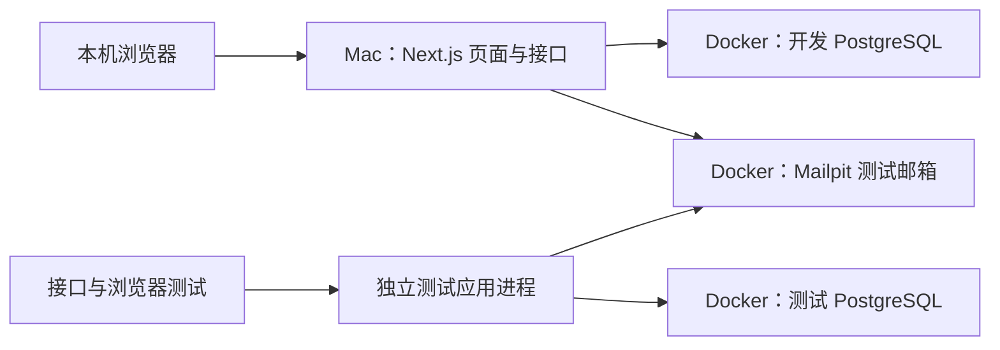

# 宝宝计划｜本地开发与测试方案

日期：2026-10-31（Asia/Shanghai）。状态：本机应用已可运行，B1 的账号、家庭、邀请、作息和手动日计划已接入真实 PostgreSQL／Mailpit。接口、浏览器及首次独立恢复验证见[本轮报告](../output/local-development-2026-10-31/report.md)。S1 尚未整体验收。

## 1. 运行方式

应用由本机 Node.js 运行。PostgreSQL 和 Mailpit 由 Docker Compose 运行。开发和集成测试都使用真实 PostgreSQL。PGlite 已从依赖和默认配置中移除，不再作为本地数据库。



开发应用运行于 127.0.0.1:3000；独立测试应用运行于 127.0.0.1:3001，构建目录为 .next-test。测试脚本先读取 .env.test 并验证环境，再派生 Next.js 进程。继承的测试配置优先于 Next.js 发现的 .env.local，服务端还会检查测试数据库名、账号与端口。

## 2. 已安装版本

| 项目 | 版本 |
| --- | --- |
| 系统 | macOS 27.0，arm64，16 GB 内存 |
| Node.js / npm | v24.14.0 / 11.9.0，沿用现有安装 |
| Docker Desktop | 4.97.0（build 244584），官方 Apple Silicon 安装包 |
| Docker Engine | 29.9.2，linux/arm64 |
| Docker Compose | v5.6.1 |
| PostgreSQL | 18.6，镜像 `postgres:18.6-bookworm`，数据目录 `/var/lib/postgresql/18/docker` |
| Mailpit | v1.32.0，镜像 `axllent/mailpit:v1.32.0` |
| Playwright | 1.64.1，仅 Chromium（Chrome for Testing 156.0.8078.4） |

Docker Desktop 首次启动时把虚拟机内存设为 8192 MiB。安装后系统卷剩余约 19 GiB。Homebrew 已安装，但当前会因尚未接受 Xcode 许可而拒绝执行，所以 Docker 使用官方 DMG，没有走 Homebrew cask。

`docker` 可从 `~/.docker/bin` 和 `~/.local/bin` 找到。新开的终端会通过 `~/.zprofile` 带上这两处路径。

## 3. 服务和数据

所有发布端口只绑定 `127.0.0.1`。Mailpit 不配置外部转发，也不会做版本检查或反向 DNS。

| 服务 | 入口 | 容器 | 数据卷 | 启动方式 |
| --- | --- | --- | --- | --- |
| 开发 PostgreSQL | `127.0.0.1:5432` | `baby-plan-postgres` | `baby-plan-dev-data` | 默认启动 |
| 测试 PostgreSQL | `127.0.0.1:5433` | `baby-plan-postgres-test` | `baby-plan-test-data` | `test` profile，按需启动 |
| Mailpit 网页 | `http://127.0.0.1:8025` | `baby-plan-mailpit` | 无持久卷 | 默认启动 |
| Mailpit SMTP | `127.0.0.1:1025` | 同上 | 无持久卷 | 默认启动 |

开发库和账号都是 `baby_plan_dev`。测试库和账号都是 `baby_plan_test`。密码和 `AUTH_SECRET` 在本机随机生成，只放在被 Git 忽略的文件里：

| 文件 | 作用 |
| --- | --- |
| `.env.compose` | Compose 读取的数据库密码 |
| `.env.local` | 本机应用配置，连接开发库和 Mailpit |
| `.env.test` | 测试进程配置，连接测试库和同一个 Mailpit |
| `.env.example` | 提交到仓库的占位示例，没有真实凭证 |

日常停止用 `npm run env:down`，只停止容器，数据卷保留。`docker compose down -v` 会删除这个 Compose 文件里的全部数据卷，包括开发库。测试库重建只能用 `npm run env:reset-test`，它只删除 `baby-plan-test-data`。

## 4. 命令

在项目目录 `/Users/jackx/Documents/ChatGPT/宝宝计划` 执行。

| 目的 | 命令 |
| --- | --- |
| 启动开发库和 Mailpit | `npm run env:up` |
| 额外启动测试库 | `npm run env:up:test` |
| 停止本项目容器 | `npm run env:down` |
| 查看状态 | `npm run env:ps` |
| 检查数据库和 Mailpit | `npm run env:check` |
| 只重建测试库 | `npm run env:reset-test` |
| 向 Mailpit 发送一封探测邮件 | `npm run env:probe-mail` |
| 检查 Playwright Chromium 能否启动 | `npm run env:verify-browser` |
| 重启开发库并确认探针数据仍在 | `npm run env:verify-persistence` |

对应的 Compose 命令是：

```bash
docker compose --env-file .env.compose up -d --wait
docker compose --env-file .env.compose --profile test up -d --wait
docker compose --env-file .env.compose --profile test stop
docker compose --env-file .env.compose --profile test ps
```

应用开发与验证命令：

| 命令 | 作用 |
| --- | --- |
| `npm run dev` / `npm run build` / `npm run start` | 开发应用／生产构建／构建后本机服务 |
| `npm run dev:test` | 3001 端口启动连接隔离测试库的应用 |
| `npm run db:migrate` | 执行开发库迁移；追加 -- --test 可迁移测试库 |
| `npm run local:setup` | 迁移并生成一次性首位账号链接，保存在 .local/first-registration-link.txt |
| `npm test` | 重建专用测试库的业务表后，执行真实 PostgreSQL／Mailpit 接口测试 |
| `npm run check` | 依次执行类型、lint、接口测试和生产构建 |
| `npm run db:verify-backup` | 备份测试库并恢复到独立临时库，逐表校验后移除恢复副本 |

首次使用先启动服务、执行 local:setup，再运行 dev。打开上述一次性链接，验证邮箱并注册首位账号，随后正常登录、创建家庭、初始化宝宝和邀请家人。脚本可重复执行；不会重置密码或追加初始化资格。

迁移按文件名顺序执行，并校验已应用内容的摘要；每份迁移在事务内提交，迁移进程通过 PostgreSQL 锁互斥。不要修改已应用 SQL，应新增迁移。

接口测试重建测试业务表，保留迁移结构，不操作开发库。重新执行会使当前测试浏览器会话失效，应先结束该轮浏览器检查。浏览器使用 .local/browser-fixture.json 中的虚拟账号；测试夹具、凭证和备份均不提交。

## 5. 环境验证结果

以下只证明本机依赖服务和工具可用，不证明注册、家庭、计划或其他业务功能。

| 检查 | 结果 |
| --- | --- |
| `docker version` | 客户端和服务端都返回 29.9.2 |
| `docker compose version` | v5.6.1 |
| 开发库 TCP 登录并执行 SQL | 已连接 `127.0.0.1:5432/baby_plan_dev` |
| 开发库重启后数据仍在 | 探针表 `env_persistence_probe` 的记录在重启后仍能读回 |
| 测试库独立重建 | 已删除并重建 `baby-plan-test-data`；开发库探针记录未变，测试库里的探针表已消失 |
| Mailpit | 通过 SMTP 发到 `127.0.0.1:1025`，收件箱 API 确认收到主题 `baby-plan-env-probe-*` 的邮件，版本 v1.32.0 |
| 端口绑定 | 5432、5433、8025、1025 的监听地址都是 `127.0.0.1` |
| Playwright | Chromium 无头启动并读到页面标题 |

开发库里的 `env_persistence_probe` 只用于这次环境验证，不是业务表。测试库容器验证后已停止，数据卷还在；需要时用 `npm run env:up:test` 再启动。

## 6. 尚未完成

- 内容／来源／11 条菜谱草稿导入、日历汇总、文字记录、30 天回收站与打印；天气、自动计划和 AI。
- [测试计划](../specs/baby-plan/test-plan.md) 的 55 项验收尚未整体通过；真实手机／平板和打印仍待验证。
- 已完成测试库独立恢复；含记录、AI 私有性、30 天删除期限和恢复点后删除流水的完整 S1 恢复仍待验证。
- 没有接入云端、真实邮箱或家庭数据。Mailpit 只证明本机收信。
- 生产 HTTPS、域名、邮件、备份周期／容量／外部副本和部署回退仍待准备。生产邮件传输目前明确拒绝，不能直接用本地 SMTP 配置上线。

恢复演练使用同一 PostgreSQL 导出快照完成备份和源数据摘要计算，再创建独立临时库恢复，逐表比较行数与内容摘要。核对后关闭并删除临时库，备份保留于被忽略的 .local/backups；不以恢复副本替换运行数据。
